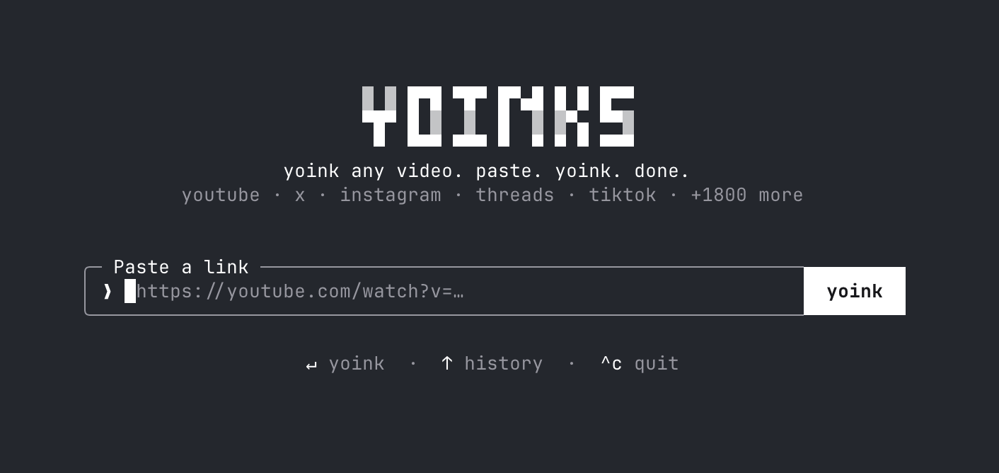
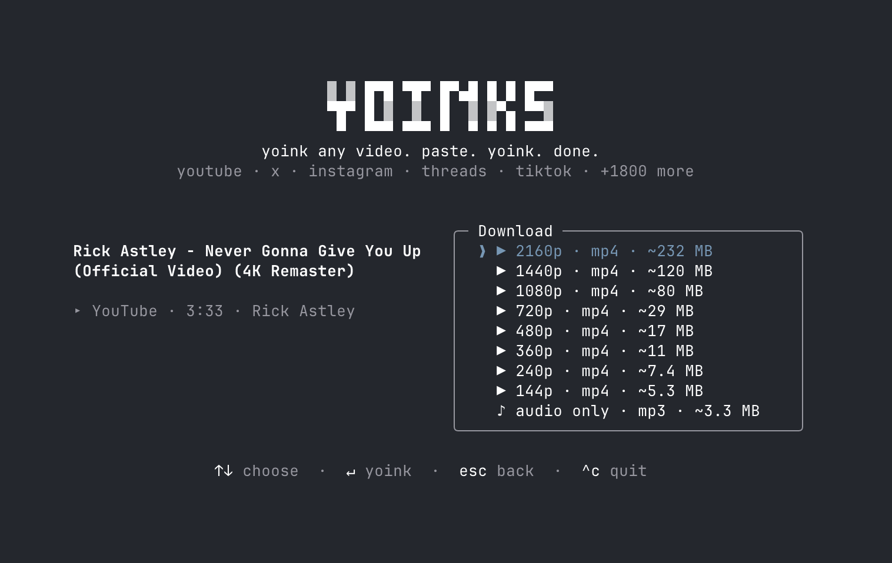

# 🧬 `@gina/yoinks-media` — GINASERVICE Sovereign Media Tool (`yoinks`)

<picture>
  <source media="(prefers-color-scheme: dark)" srcset="assets/logo-dark.svg">
  
</picture>

**yoink any video. paste. yoink. done.**

- **Document Reference:** `GINA-ANTIGRAVITY-YOINKS-GITHUB-2026-V1`
- **Classification & Security Gate:** `SEC-L1 / TS-L1 Open-Source Integration` (`GINA-SEC-7L-2026` — `S_leak = 0.00`, `R_secret = 1.0`, `R_legal = 1.0`)
- **Institutional Umbrella:** GINASERVICE SARL AU (Casablanca RC N° 214563) & ReferPay DAO (Singapore CLL#16219882)
- **Upstream Source:** [`pablostanley/yoinks`](https://github.com/pablostanley/yoinks) (MIT License © Pablo Stanley)

Download videos from YouTube, X/Twitter, Instagram, Threads, TikTok and 1,800+ other sites — interactively from your terminal via Ink TUI, headlessly via CLI flags for `DIR-5` Marketing Swarm agents, or via the `gina_yoink_media` Model Context Protocol (MCP) tool.



---

## 🏛️ 7-File × 7-Property × 7-Account Sovereign Architecture Mapping

| # | Modular Architecture File | Embedded Algorithmic Property | Sovereign Supervisor (`GINA-SEC-7L-2026`) | Operational Role in `gina-yoinks-media` |
|---|---|---|---|---|
| **01** | [`01-web3-blockchain-architect.md`](../../docs/architecture/01-web3-blockchain-architect.md) | Intent Completeness (`S_comp`) & Proactive Inquiry | `SEC-01`: `argon.sec-01.ciso@security.ginaservice.com` | Verifies `FP_runtime` & `HMAC-SHA256`, linking media SHA-256/Merkle hashes to IPFS/Arweave & TON (`TEP-74`) / EVM (`ERC-4337`) creator rights. |
| **02** | [`02-legal-compliance-counsel.md`](../../docs/architecture/02-legal-compliance-counsel.md) | Dynamic Skill Routing (`Chameleon Scales`) | `SEC-02`: `argon.sec-02.ztna@security.ginaservice.com` | Preserves upstream MIT License (`TS-L1`), complies with Moroccan Law 09-08 & GDPR, and enforces 30s ephemeral `SIACP` sessions. |
| **03** | [`03-strategic-growth-persuasion.md`](../../docs/architecture/03-strategic-growth-persuasion.md) | Hybrid Execution (Singapore Cloud + Casablanca Edge) | `SEC-03`: `argon.sec-03.icam@security.ginaservice.com` | Serves `DIR-5` Marketing Swarm (`@comms.ginaservice.com`) for 9:16 vertical promotional video production for Gina Market & ReferPay (50% commission / 50 MAD/yr) under Bell-LaPadula & Biba (`SEC-L1/TS-L1`). |
| **04** | [`04-fintech-payment-systems.md`](../../docs/architecture/04-fintech-payment-systems.md) | Reverse Auditing & MCP Container Isolation (`--cap-drop=ALL`) | `SEC-04`: `argon.sec-04.arti@security.ginaservice.com` | Strictly isolates the Moroccan Patent No. 30828 zero-fee transfer engine from media containers and enforces URL quarantine (`Theta < 0.85`). |
| **05** | [`05-red-team-devils-advocate.md`](../../docs/architecture/05-red-team-devils-advocate.md) | 3-Tier Memory, `DocumentMutexLock` & AST Locks | `SEC-05`: `pro.sec-05.emsi@security.ginaservice.com` | Pre-execution SHA-256 verification of `yt-dlp` and `ffmpeg-static`, SSRF/Command Injection blocking, and Redis AST lock (`lock:repo:packages/gina-yoinks-media`). |
| **06** | [`06-workspace-operations-admin.md`](../../docs/architecture/06-workspace-operations-admin.md) | Trade-Secret Gate `GINA-TSIU` (`S_leak = 0.00`) | `SEC-06`: `argon.sec-06.tsiu-lead@security.ginaservice.com` | Automates media routing (`-o <dir>`) for Google Drive archival while scrubbing sensitive environment variables (`S_leak = 0.00`, `R_secret = 1.0`). |
| **07** | [`07-idea-engineering-evolution.md`](../../docs/architecture/07-idea-engineering-evolution.md) | Self-Evolution (`S_evolve`), WORM Log & `<2s` Rollback | `SEC-07`: `pro.sec-07.worm-audit@security.ginaservice.com` | Emits immutable SHA-256 WORM audit JSON (`--json-audit` / `--worm-log`) for `audit-stream@ginaservice.com` with Merkle root attestation. |

---

## 🚀 Usage (Interactive TUI & Headless `DIR-5` Agent CLI)

```sh
# Interactive Ink Terminal UI
$ yoinks https://youtu.be/dQw4w9WgXcQ    # straight to the format picker
$ yoinks                                 # prompts for a url
$ yoinks --theme light                   # force the light palette

# Headless Automation Mode for DIR-5 Marketing Swarm Agents
$ yoinks --best -o /tmp/yoinks-downloads --worm-log https://youtu.be/dQw4w9WgXcQ
$ yoinks --mp3 -o ./drive-audio --json-audit https://x.com/user/status/123456
```

### CLI Options
- `--best`: Automatically download highest available MP4 video quality (skips interactive picker).
- `--mp3`: Automatically extract audio-only in MP3 format (skips interactive picker).
- `-o <dir>` / `--output=<dir>`: Specify output directory (defaults to `~/Downloads`).
- `--json-audit` / `--worm-log`: Emit signed `YoinksAuditRecord` JSON with SHA-256 file hash for `audit-stream@ginaservice.com`.
- `--theme <mode>`: Use `auto`, `light`, or `dark` for the interactive TUI.
- `-h, --help`: Show help message.
- `-v, --version`: Show version.



---

## 🔌 MCP Server (`gina_yoink_media`)

`@gina/yoinks-media` exposes a built-in Model Context Protocol (MCP) server over stdio (`dist/mcp_server.js`) registering the `gina_yoink_media` tool:

```sh
node dist/mcp_server.js
```

---

## 🐳 Layer 4 Sandboxed Container (`Dockerfile.yoinks-sandbox`)

```sh
docker build -f Dockerfile.yoinks-sandbox -t gina-yoinks-sandbox:latest .

docker run --rm \
  --cap-drop=ALL \
  --security-opt=no-new-privileges:true \
  --read-only \
  --tmpfs /tmp/yoinks-downloads:rw,noexec,nosuid,size=2g \
  gina-yoinks-sandbox:latest --best -o /tmp/yoinks-downloads --worm-log https://youtu.be/dQw4w9WgXcQ
```

---

## 🛠️ Development

```sh
npm install
npm run typecheck    # TypeScript strict verification
npm test             # Unit & GINA-SEC-7L-2026 security quarantine tests
npm run build        # Bundle CLI, MCP server, and SDK to dist/ with tsup
```

## 📄 License

[MIT](LICENSE) — Original work Copyright (c) 2026 Pablo Stanley (`pablostanley/yoinks`), Sovereign Integration Copyright (c) 2026 GINASERVICE SARL AU & ReferPay DAO (`TS-L1`).
